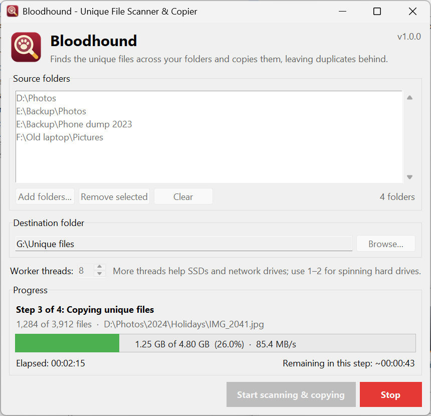

<p align="center">
  
</p>

<h1 align="center">Bloodhound</h1>

<p align="center">
  Finds the unique files across many folders and copies them into one place, leaving the duplicates behind.
</p>

<p align="center">
  
</p>

Point Bloodhound at a handful of folders (old backups, phone dumps, a copy of a
copy of your photo library) and a destination. It compares every file by its
contents, not its name, and copies exactly one copy of each into the
destination, keeping the original folder structure. Each copy is then checked
against its source.

## Features

- **Duplicates found by content.** Files are compared with SHA-256, so renamed
  copies are still caught and files that merely share a name are never mixed up.
- **Fast.** Only files that share a size with another file need hashing, and the
  work is spread over a pool of worker threads.
- **Several folders at once.** Ctrl- or Shift-click several folders in the folder
  picker, and add more from other places.
- **Live progress.** The bar shows how much has been processed in KB/MB/GB, the
  current speed, how much time has passed and how much is left.
- **Stop at any time.** Nothing half-copied is left behind. Run it again with
  the same destination to resume where it stopped.
- **Verified copies.** Every copy is re-read and compared with its source; a
  mismatch is copied again.
- **No dependencies.** Pure Python standard library (Tkinter). Runs on Windows,
  macOS and Linux.

## Requirements

- Python **3.10 or newer** with Tkinter.
  - Windows and macOS: the installers from [python.org](https://www.python.org/downloads/) include Tkinter.
  - Linux: install it from your package manager, e.g. `sudo apt install python3-tk` (Debian/Ubuntu)
    or `sudo dnf install python3-tkinter` (Fedora).

You don't need Python at all if you use a prebuilt `Bloodhound.exe`
(see [Building a standalone executable](#building-a-standalone-executable)).

## Installation

Clone or download the project, then create a virtual environment inside it.

**Windows (PowerShell)**

```powershell
cd Bloodhound
py -m venv .venv
.venv\Scripts\Activate.ps1
pip install .
```

**macOS / Linux**

```bash
cd Bloodhound
python3 -m venv .venv
source .venv/bin/activate
pip install .
```

`pip install .` adds a `bloodhound` command that opens the app. Use
`pip install -e ".[dev]"` instead if you plan to change the code.

## Running

After `pip install .`, start the app with:

```bash
bloodhound
```

or run the package as a module, which also works straight from a checkout
without installing anything:

```bash
python -m bloodhound
```

In PyCharm, create a Python run configuration and set **Module name** to `bloodhound`.

## Quick start

1. Click **Add folders…** and select one or more folders to scan. Ctrl-click or
   Shift-click to pick several at once; click it again to add folders from elsewhere.
2. Click **Browse…** to choose the **destination folder**.
3. Click **Start scanning & copying**.
4. Watch the progress, or click **Stop** at any time. A summary appears when the job ends.

Each source gets its own folder inside the destination:

```text
G:\Unique files\
├── Photos\              ← from D:\Photos
├── Photos (2)\          ← from E:\Backup\Photos (same name, so it is numbered)
└── Phone dump 2023\     ← from E:\Backup\Phone dump 2023
```

When the same file exists in several places, the copy found first is kept: folders
are read in the order they appear in the list, and each folder alphabetically.

The [user guide](docs/USER_GUIDE.md) covers every option, what the progress readout
means, resuming, and troubleshooting.

## How it works

| Step | What happens |
|------|--------------|
| 1. Scanning | Lists every file in the source folders with its size. |
| 2. Comparing | Files with a size no other file has are unique by definition. The rest are hashed with SHA-256 in parallel to find identical ones. |
| 3. Copying | One copy of each unique file is copied (in parallel) through a temporary file that is renamed into place only once it is complete. |
| 4. Verifying | Every copy is read back and its hash compared with the source. Mismatches are copied again. |

More detail, including the threading model, is in [ARCHITECTURE.md](docs/ARCHITECTURE.md).

## Building a standalone executable

[PyInstaller](https://pyinstaller.org/) can bundle Bloodhound and Python into a single
program, with the Bloodhound icon, for people who don't have Python installed:

```bash
pip install -r requirements-dev.txt
pyinstaller packaging/bloodhound.spec
```

The result is `dist/Bloodhound.exe` on Windows (`dist/Bloodhound` on macOS/Linux).
Build on the operating system you are targeting.

## Development

```bash
pip install -r requirements-dev.txt
pytest
```

The icon is drawn by `scripts/generate_icon.py`; run it again after changing the design.
See [CONTRIBUTING.md](CONTRIBUTING.md) for the project layout and conventions.

## Project structure

```text
Bloodhound/
├── bloodhound/              the application package
│   ├── __main__.py          `python -m bloodhound`
│   ├── app.py               main(): creates the window (the `bloodhound` command)
│   ├── core/                file processing, no GUI code
│   │   ├── engine.py        the 4-step job and its thread pool
│   │   ├── scanner.py       walking the source folders
│   │   ├── hashing.py       chunked, cancellable hashing and copying
│   │   ├── progress.py      thread-safe counters, speed and time left
│   │   ├── models.py        data passed between engine and GUI
│   │   └── errors.py
│   ├── gui/                 Tkinter interface
│   │   ├── main_window.py   the main window
│   │   ├── widgets.py       folder list, text progress bar, problems dialog
│   │   ├── folder_picker.py choosing several folders at once
│   │   ├── _win_folder_dialog.py  native Windows multi-folder dialog (ctypes)
│   │   └── icon.py
│   ├── utils/               formatting and path helpers
│   └── assets/              icon files
├── tests/                   pytest suite
├── docs/                    user guide, architecture notes, screenshot
├── packaging/               PyInstaller recipe
├── scripts/                 icon generator
├── pyproject.toml           package metadata
└── requirements*.txt        dependencies
```

## License

Bloodhound is released under the [MIT License](LICENSE).
